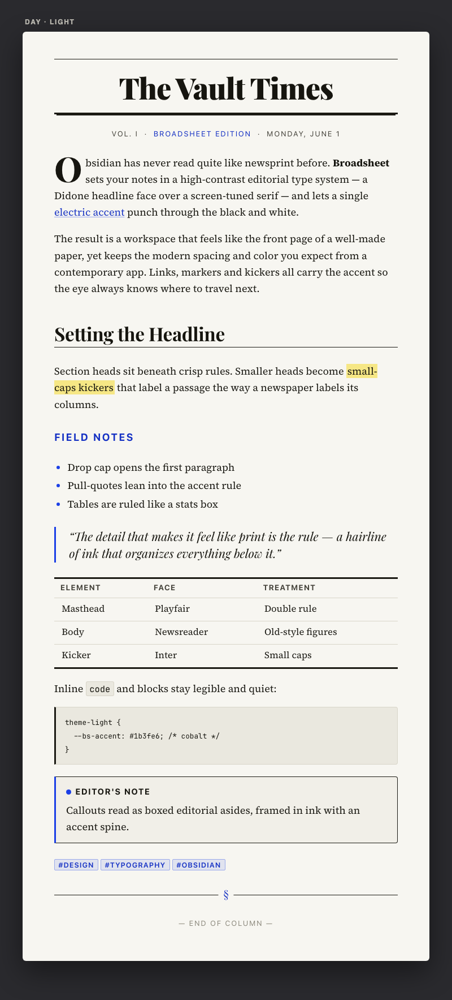
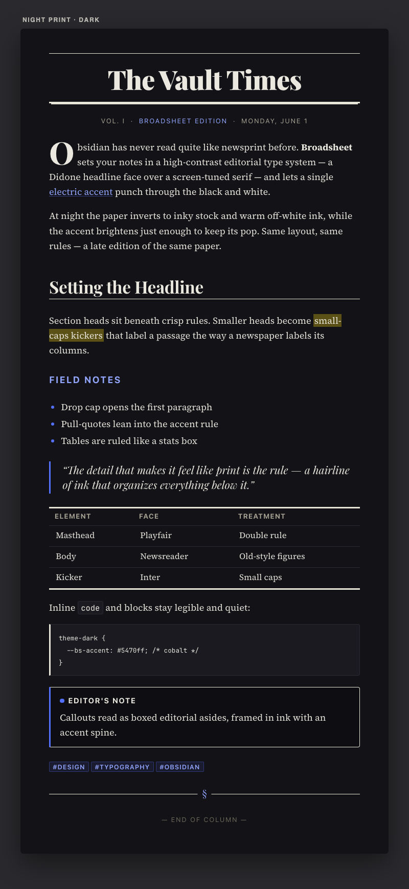

# Broadsheet

A modern **newspaper** theme for [Obsidian](https://obsidian.md). High-contrast newsprint typography meets one electric accent — black, white, and a single pop of color. Ships with light (**Day**) and dark (**Night Print**) modes.

> _Set your notes like the front page of a well-made paper, with the spacing and color of a contemporary app._

## Screenshots

| Day (Light) | Night Print (Dark) |
| --- | --- |
|  |  |

## Features

- **Editorial type system** — uses locally installed editorial faces when present (**Playfair Display** for headlines, **Newsreader** or **Source Serif 4** for body copy, **Inter** for labels and UI, **JetBrains Mono** for code) and degrades cleanly to system serif, sans, and monospace stacks with zero network requests.
- **Masthead note titles** — the inline title becomes a centered nameplate framed by classic double rules, with a hairline eyebrow rule above.
- **Drop caps** — the first paragraph of each note opens with a large initial in reading view.
- **Kickers & small caps** — H4–H6, tags, table headers, and metadata keys render as uppercase letter-spaced labels.
- **Pull-quotes** — blockquotes become italic display quotes with an accent spine.
- **Ruled tables** — bold top/bottom rules and hairline row rules, like a newspaper stats box.
- **Section dividers** — horizontal rules carry a centered `§` ornament.
- **Four accent presets** — Cobalt (default), Magenta, Tangerine, and Ink (monochrome), swappable via Style Settings.
- **Full UI pass** — tabs, sidebars, ribbon, status bar, command palette, menus, callouts, and properties all share the newsprint palette and rules.

## Install

### Manual install (works today)

Obsidian only needs `manifest.json` and `theme.css` inside a folder named `Broadsheet` under your vault's `.obsidian/themes/` directory.

```sh
git clone https://github.com/KilianTheMagnificent/broadsheet-obsidian-theme.git "<your-vault>/.obsidian/themes/Broadsheet"
```

Or copy `manifest.json` and `theme.css` manually so your vault has:

```text
<your-vault>/.obsidian/themes/Broadsheet/manifest.json
<your-vault>/.obsidian/themes/Broadsheet/theme.css
```

Then in Obsidian:

1. Open **Settings → Appearance → Themes** and select **Broadsheet** (restart Obsidian if the theme was copied while the app was open).
2. Switch **Settings → Appearance → Base color scheme** between **Light** and **Dark** to toggle between *Day* and *Night Print*.

> Only `manifest.json` and `theme.css` are required by Obsidian. The `docs/`, `preview/`, and `snippets/` folders are optional extras ignored by Obsidian's theme loader.

### Obsidian Community Themes

Once Broadsheet is published to the Obsidian Community Themes directory, you will also be able to install it directly inside Obsidian via **Settings → Appearance → Themes → Manage → search for "Broadsheet" → Install and use**. (See [`docs/obsidian-community-submission.md`](./docs/obsidian-community-submission.md) for the release and directory submission checklist.)

## Recommended: Style Settings

Install the community plugin **Style Settings** to unlock a control panel for Broadsheet (**Settings → Style Settings → Broadsheet**):

| Control | What it does |
| --- | --- |
| **Body font size** | Base reading size (`14–24px`, default `18px`) |
| **Column width** | Readable line length / measure (`28–62rem`, default `40rem`) |
| **Headline font** | Playfair Display · Newsreader · System serif |
| **Accent** | Cobalt · Magenta · Tangerine · Ink (monochrome) |
| **Disable drop caps** | Turn off the large initial letter on the first paragraph |
| **Disable masthead rules** | Turn off the double rules under the note title and H1 |
| **Justified body text** | Justify paragraphs with automatic hyphenation |
| **Disable small-caps labels** | Plain-case H4–H6 headings, tags, table headers, and metadata keys |

Everything has sensible defaults, so Broadsheet works cleanly **without** Style Settings too.

## Customizing the accent by hand

Without Style Settings, you can override the accent color in a CSS snippet (**Settings → Appearance → CSS snippets**):

```css
body.theme-light { --bs-accent: #0e9f6e; --bs-accent-text: #0b7d57; }
body.theme-dark  { --bs-accent: #34d399; --bs-accent-text: #6ee7b7; }
```

`--bs-accent` drives fills, markers, and spines; `--bs-accent-text` is the contrast-tuned shade used for link and tag text.

## Companion snippets

The [`snippets/`](./snippets/) folder contains two optional Broadsheet-tuned CSS snippets adapted from MIT-licensed snippets by **Travis Abendshien (CyanVoxel)** (full attribution and license text in [`THIRD_PARTY_NOTICES.md`](./THIRD_PARTY_NOTICES.md)):

- **[`Daily Note Themes (Broadsheet).css`](./snippets/Daily%20Note%20Themes%20%28Broadsheet%29.css)** — per-weekday color schemes for daily notes (adapted from CyanVoxel's *Obsidian Daily Themes* v1.0.5). Each weekday's hue drives Broadsheet's accent over a subtle tinted page wash in both light and dark modes. Add to a daily note's frontmatter:
  ```yaml
  cssclasses:
    - daily
    - monday   # lowercase or Capitalized weekday names both work
  ```
- **[`Colored Sidebar Items (Broadsheet).css`](./snippets/Colored%20Sidebar%20Items%20%28Broadsheet%29.css)** — color-codes folders by numeric prefix (`00`–`07`, `99`, adapted from CyanVoxel's *Obsidian Colored Sidebar* v2.0.0), re-based onto Broadsheet's warm ink and paper palette.

To use either snippet, copy the `.css` file into `<your-vault>/.obsidian/snippets/` and enable it under **Settings → Appearance → CSS snippets**. Enable only **one** version of each snippet (disable the originals if installed to avoid rule conflicts).

## Fonts (100% offline-safe)

Broadsheet uses **local and system font stacks only** — `theme.css` has **no `@import` rules and makes zero external network requests**.

- **If installed locally on your computer**, Broadsheet automatically picks up:
  - Headlines: **Playfair Display** (falls back to **Newsreader**, **Georgia**, system serif)
  - Body text: **Newsreader** or **Source Serif 4** (falls back to **Georgia**, **Times New Roman**, system serif)
  - UI & kicker labels: **Inter** (falls back to `-apple-system`, `BlinkMacSystemFont`, `Segoe UI`, `Roboto`, sans-serif)
  - Code: **JetBrains Mono** (falls back to `SFMono-Regular`, `ui-monospace`, `Cascadia Code`, monospace)
- **Out of the box without extra fonts**, Broadsheet renders completely offline using your platform's built-in serif, sans, and monospace fonts.
- You can also override any font directly in Obsidian under **Settings → Appearance → Font**.

## Local browser preview

Offline HTML previews live in [`preview/`](./preview/) with zero external dependencies:

- [`preview/index.html`](./preview/index.html) — Day and Night Print side by side
- [`preview/livepreview.html`](./preview/livepreview.html) — Live Preview heading rules and daily masthead check
- [`preview/daily.html`](./preview/daily.html) — Daily Note Themes companion snippet preview
- [`preview/sidebar.html`](./preview/sidebar.html) — Colored Sidebar Items companion snippet preview

Open any file directly in a browser, or run `python3 preview/serve.py` and visit `http://127.0.0.1:4178/`.

## Status & how this was built

- **Current status:** `v1.0.0` — ready for manual installation in Obsidian 1.4.0+ and prepared for Obsidian Community Themes submission.
- **Scope:** Broadsheet is a static CSS theme. It contains no executable scripts, makes no external network requests, and does not handle logins, encryption, backups, or passwords.
- **How this was built:** Andre Romero directed the visual design, typography choices, and theme refinement with AI coding assistants, checking the rendered previews and Obsidian views directly. Bug reports and styling feedback are welcome via [GitHub Issues](https://github.com/KilianTheMagnificent/broadsheet-obsidian-theme/issues); outside pull requests are turned off (see [CONTRIBUTING.md](./CONTRIBUTING.md)).

## License & third-party notices

Broadsheet is released under the **MIT License** — `Copyright (c) 2026 Andre Romero` (see [`LICENSE`](./LICENSE)).

The optional companion snippets under `snippets/` adapt MIT-licensed CSS by **Travis Abendshien (CyanVoxel)** (`Copyright (c) 2024 Travis Abendshien`). Full upstream credits and the verbatim MIT license text are preserved in [`THIRD_PARTY_NOTICES.md`](./THIRD_PARTY_NOTICES.md) and in each snippet file header.
